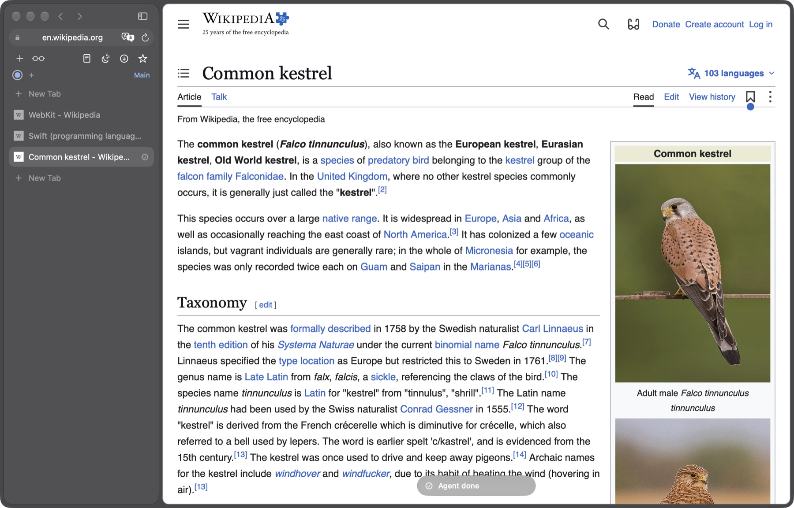
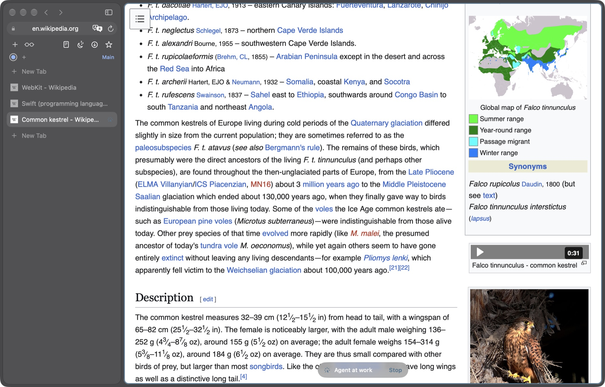
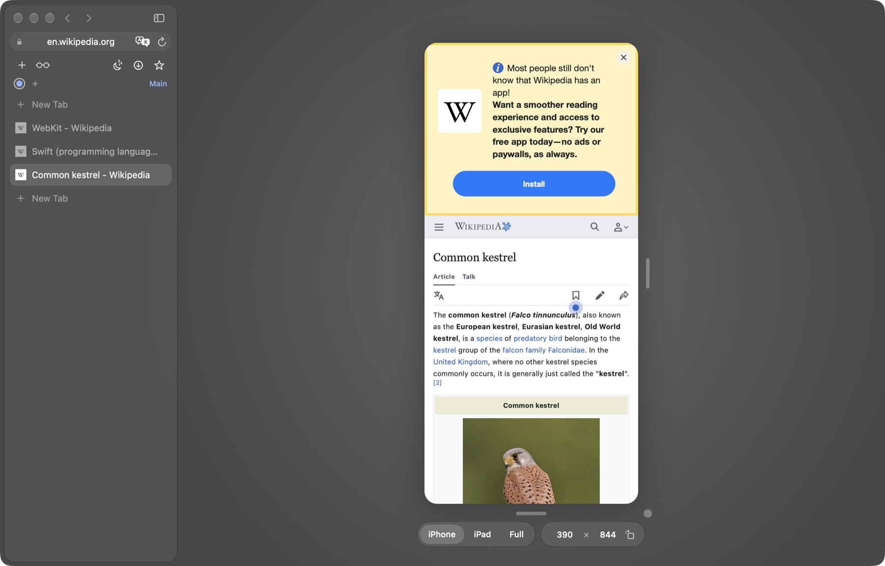

# Backlight

A small, quiet web browser for macOS 27, written in Swift on the WebKit that
ships with the Mac. The page gets the whole window, and the AI agent you
already use can work in it too, with your say.

No dependencies, no telemetry, no account. [Website](https://mbahakeskin.github.io/Backlight/) ·
[Download](https://github.com/mbahakeskin/Backlight/releases/latest) ·
[Everything it does](FEATURES.md)

<p align="center"></p>

Backlight answers three questions:

- Can a browser keep out of the way? Tabs wait in a sidebar at the left edge
  and the address at the top, and neither takes room until the pointer reaches it.
- Can it be small? Under 5 MB installed, a 2 MB download, nothing but Swift and
  the frameworks that ship with the Mac.
- Can an agent use my own browser, with my sign-ins, without a second one to
  log in to? Yes: 50 tools over MCP, asked per site.

macOS only. Needs macOS 27.

## Screenshots

An agent at work: the page is framed and a pill says so, with a Stop button.
The first time it reads or acts on a site, you are asked.

<p align="center"></p>

Responsive Design (Develop menu): the page is told it is a phone's or a
tablet's size, in a frame, with the user agent to match.

<p align="center"></p>

## Install

**Download.** Get `Backlight-<version>.zip` from the
[latest release](https://github.com/mbahakeskin/Backlight/releases/latest),
unzip it and drag Backlight to Applications. The app is signed but not
notarized, so macOS may refuse it at first: System Settings › Privacy &
Security has an Open Anyway button, or use the Terminal install below.

**Terminal.** `curl` does not mark what it fetches as downloaded from the
internet, so macOS has nothing to ask about:

```sh
curl -s https://api.github.com/repos/mbahakeskin/Backlight/releases/latest \
  | grep -o 'https://[^"]*\.zip' | xargs curl -sL -o /tmp/Backlight.zip \
  && unzip -q -o /tmp/Backlight.zip -d /Applications && open /Applications/Backlight.app
```

**From source.** Needs the Command Line Tools (Swift 6.4); Xcode is not required.

```sh
git clone https://github.com/mbahakeskin/Backlight.git && cd Backlight
./build.sh agent      # build/Backlight.app, with the agent tools (what a release is)
./build.sh            # the plain browser, without them
```

Updates: a release build looks at GitHub once a day and installs nothing
without your say (Settings › General turns the check off).

## What is in it

- **Windows and tabs.** Sidebar and top bar that slide in from their edges (or
  stay pinned), a new tab that is a field over the page, groups, profiles with
  their own sign-ins, split view, private tabs that live in memory only. Tabs
  off screen are frozen and, after a while, unloaded.
- **Reading and saving.** Reader (⌥⌘R), dark pages, Peek (Shift-click a link),
  Translate Page on this Mac, picture in picture, the page as one image,
  downloads you can pause, a button for photos and videos on the sites you list.
- **Privacy.** Nothing leaves but the pages you open. Ads and trackers are
  blocked by uBlock Origin Lite; tracking parameters are cut from links.
- **Extensions.** Chrome Web Store, an unpacked folder, or a Safari extension
  from its app. Bitwarden works, Touch ID included.
- **For developers.** Develop and Debug menus as in Safari, any user agent or
  size, and settings kept per site.

All of it, one line each, is in [FEATURES.md](FEATURES.md).

## Agents

Turn it on in Settings › Agents and connect: one button adds Backlight to Claude
Code, others write it into the Claude app or Antigravity, or copy the entry for
any other MCP client. The agent starts `Backlight --mcp`, which talks to the
running browser over a socket only your user can open.

- It reads, clicks, types, scrolls and drags; fills forms; reads many pages in
  one call; takes screenshots; and, with the developer tools on, runs scripts and
  sees the console and the network.
- You decide per site: not now, read only, or read and act. Private tabs are
  never shown to it, and neither are password and card fields.
- A call with no tab goes to the tab the agent opened last, never to the one you
  are looking at. Closing "its tabs" closes only tabs it opened.
- A page can be marked for it with Pick Element: it gets the selector, text,
  styles and the React or Vue component.

How this compares with Claude's own browser and Claude in Chrome, and what each
tool does, is in [FEATURES.md](FEATURES.md#why-this-and-not-claudes-browser-claude-in-chrome-or-chatgpts-extension).

## Not yet

- **Passkeys.** WebKit gives them to a browser only with an entitlement Apple
  grants on request, tied to a paid developer account. Password managers that
  are extensions work.
- **Pages built only for Chrome.** It is WebKit, like Safari.
- **Device emulation, in part.** Touch is made by a script and a slow network
  by the inspector, not by the engine.

## Numbers

Measured on a MacBook Air (M3), macOS 27, with the method on the
[website](https://mbahakeskin.github.io/Backlight/#numbers): 4.6 MB installed
(Chrome 1,459 MB, Arc 900 MB, Safari 35 MB), a hidden tab at 0.9% of a core
once frozen, a first window in 0.08 s.

## Credits

Parts of Backlight (the address parser, the traffic-light placement, the
Safari user-agent handling, the WebSocket an extension's worker gets, and the
page script and colour engine of dark pages) are adapted from
[Search](https://github.com/driceroland/Search) by Office Commun, under the
MIT license. See [LICENSE](LICENSE).
